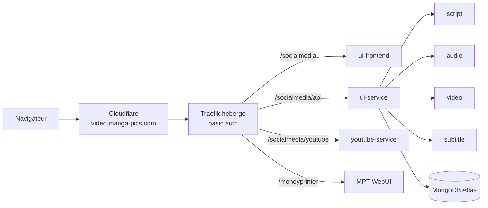
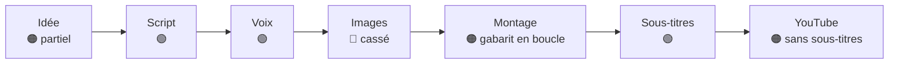
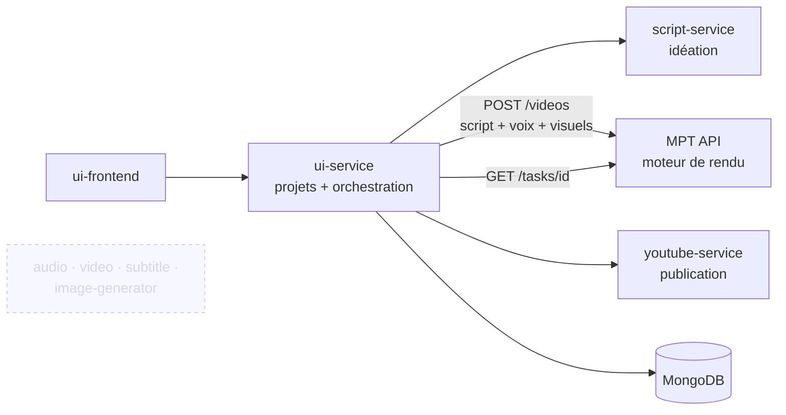
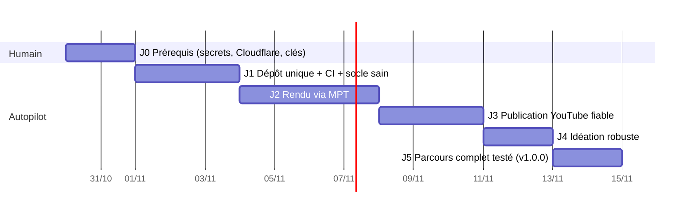

# État des lieux social-media et comparaison avec MoneyPrinterTurbo — 29/10/2026

## Sommaire
- [1. Déploiement sur work](#1-déploiement-sur-work)
- [2. Où en est social-media](#2-où-en-est-social-media)
  - [2.1 Parcours vidéo, étape par étape](#21-parcours-vidéo-étape-par-étape)
  - [2.2 Bugs bloquants](#22-bugs-bloquants)
- [3. social-media vs MoneyPrinterTurbo](#3-social-media-vs-moneyprinterturbo)
- [4. Recommandation](#4-recommandation)
- [5. Reste à faire pour une V1](#5-reste-à-faire-pour-une-v1)
- [6. Plan pour l'autopilot](#6-plan-pour-lautopilot)

Abréviations : **MPT** = [MoneyPrinterTurbo](https://github.com/harry0703/MoneyPrinterTurbo) ; **SM** = social-media ; **TTS** = synthèse vocale (*text-to-speech*) ; **OAuth** = connexion déléguée à un compte Google.

# 1. Déploiement sur work

| Élément | État |
|---|---|
| 9 conteneurs (8 SM + MPT) | ✅ sains |
| Routes via Traefik (contrôlées à l'origine) | ✅ 200 avec identifiants, 401 sans |
| Accès public via Cloudflare | ❌ boucle de redirection : Cloudflare est en SSL « Flexible » → passer `video.manga-pics.com` en **Full (strict)** (certificat Let's Encrypt déjà obtenu) |
| Exploitation | `video status \| logs \| restart \| up \| down \| build \| health [sm\|mpt\|all] [service]` |
| Config | [`docker-compose.work.yml`](../docker-compose.work.yml), [`moneyprinter/`](../moneyprinter), [`deploy-manifest.yml`](../deploy-manifest.yml) |

# 2. Où en est social-media

**≈ 50 % d'une V1.** La chaîne existe de bout en bout, mais elle n'a pas d'images, publie la vidéo sans ses sous-titres et n'a ni authentification ni tâches asynchrones.

## 2.1 Parcours vidéo, étape par étape

| Étape | Service | Constat |
|---|---|---|
| Idée | script-service | Vidéos d'inspiration obligatoires ; correctif *bot-detection* non fusionné |
| Script | script-service (DeepSeek) | `nb_section` et `duration` perdus en route |
| Voix + SRT | audio-service (ElevenLabs) | OK |
| Images | ui-service → `image-service:8003` | Ce service **n'existe pas** |
| Montage | video-service | Boucle une vidéo gabarit, ignore les images, pas de miniature |
| Sous-titres | subtitle-service | OK, mais transcrit une 2ᵉ fois (AssemblyAI payé deux fois) |
| Publication | youtube-service | Envoie la vidéo **non sous-titrée** ; miniature toujours en échec |

## 2.2 Bugs bloquants

| # | Problème | Où |
|---|---|---|
| 1 | 🔐 Secret client OAuth Google en dur et commité | `youtube-service/app/core/config.py:41-42` |
| 2 | Aucune authentification (contournée sur work par un basic auth) ; `/debug/resources` expose le disque | `ui-service/app/main.py:75` |
| 3 | URL des services sans suffixe de route → 404 si le `.env` de prod n'est pas recopié | `ui-service/app/services/*_service.py` |
| 4 | Appel à un service d'images inexistant | `ui-service/app/core/config.py:40` |
| 5 | Gabarit `''` non détecté, puis `os.path.exists(None)` | `ui-service/app/services/video_service.py:112,123` |
| 6 | Miniature : champ renommé d'un côté et pas de l'autre | `video_service.py:163`, `youtube_thumbnail_service.py:124` |
| 7 | Upload de la vidéo non sous-titrée | `youtube_upload_service.py:126` |
| 8 | Retour OAuth vers `/config`, une page qui n'existe pas | `youtube_auth_routes.py:55` |
| 9 | Projet neuf (`id='temp'`) : l'appel au LLM est payé, puis la sauvegarde échoue en 404 | `ProjectEditorPage.jsx:150+` |
| 10 | Tâches longues synchrones (moviepy dans de l'`async`) : un rendu fige le service | `video-service`, `subtitle-service`, `youtube-service` |
| 11 | Police Montserrat introuvable au build (404) → police de secours | `subtitle-service/Dockerfile` |

**Tests** : aucun test lancé en CI ; 0 test sur audio, script, youtube et frontend. **Dépôts** : 12 dépôts, dont 4 inutiles pour une V1 (heygen-playwright, img-to-video-service, fast-api-template2 ; image-and-video-generator n'est branché nulle part).

# 3. social-media vs MoneyPrinterTurbo

| Critère | social-media | MoneyPrinterTurbo |
|---|---|---|
| Maturité | Prototype, ~50 %, inactif depuis déc. 2025 | 136 k ⭐, MIT, commit le jour même |
| Vidéo de bout en bout | 🟠 avec bugs | 🟢 sujet → script → visuels → voix → sous-titres → musique → MP4 |
| Visuels | Gabarit en boucle | Banques de vidéos (Pexels, Pixabay), images IA, vidéos IA, fichiers locaux |
| Voix | ElevenLabs | Edge (gratuit), ElevenLabs, Azure, etc. |
| Tâches longues | Synchrones (bloquantes) | File de tâches + statut (`POST /videos`, `GET /tasks/{id}`) |
| Idéation à partir de vidéos de référence | 🟢 spécifique | ❌ |
| Bibliothèque de projets, édition étape par étape | 🟢 MongoDB | ❌ (tâches sur disque) |
| Publication YouTube native + programmation | 🟠 | ❌ (seulement via Upload-Post, service tiers payant) |
| Multi-utilisateur, authentification | ❌ | ❌ (Streamlit mono-utilisateur, clés éditables dans l'UI) |
| Maintenance pour toi | 12 dépôts à faire vivre | Image amont à mettre à jour |
| Autopilot | ❌ multi-dépôts (l'autopilot ne gère qu'un dépôt) | n/a (code amont) |

**Ce qui a été prouvé sur work (29/10)**

| Test | Résultat |
|---|---|
| SM : 8 services + lecture des projets Atlas | ✅ |
| MPT : script DeepSeek en français | ✅ |
| MPT : visuels générés par OpenAI | ❌ **compte OpenAI sans crédit** (HTTP 429) |
| MPT : vidéo complète avec visuels locaux + voix Edge + sous-titres incrustés | ✅ MP4 1080×1920, 79 s, en **~11 min** (2 CPU partagés avec les runners) |
| MPT WebUI : page, santé, WebSocket via Traefik | ✅ 200 / 200 / 101 |

# 4. Recommandation

**MPT ne remplace pas SM, mais il remplace sa partie la plus fragile.** Garder SM comme produit (idéation, projets, publication YouTube) et confier le **rendu** à l'API de MPT.

| Pourquoi | Effet |
|---|---|
| MPT règle déjà les bugs 4, 5, 7 (vidéo sous-titrée), 10 et la double transcription | ~40 % du reste à faire disparaît |
| 4 services supprimés, regroupement en 1 dépôt | maintenance divisée par 3, **autopilot possible** |
| Ton savoir-faire propre (idéation, YouTube) est conservé | pas de régression fonctionnelle |

Si tu veux seulement produire des vidéos « sans visage » à la chaîne, **MPT seul suffit dès aujourd'hui** : il manque alors juste une clé Pexels gratuite et la publication.

# 5. Reste à faire pour une V1

| Priorité | Travail | Taille | Qui |
|---|---|---|---|
| P0 | Révoquer le secret OAuth Google, le sortir du code | S | 👤 + autopilot |
| P0 | Cloudflare : Full (strict) pour `video.manga-pics.com` | S | 👤 |
| P0 | Crédit OpenAI **ou** clé [Pexels](https://www.pexels.com/api/) (gratuite) | S | 👤 |
| P0 | Déclarer `https://video.manga-pics.com/socialmedia/youtube/auth/callback` dans la console Google | S | 👤 |
| P0 | Merger [ui-frontend#6](https://github.com/social-media-org/ui-frontend/pull/6) et [docker-compose#2](https://github.com/social-media-org/docker-compose/pull/2) | S | 👤 |
| P0 | Regrouper les dépôts utiles dans un seul dépôt + CI avec tests | M | autopilot |
| P0 | Rendu via l'API MPT (tâche + suivi d'avancement dans l'UI) | M | autopilot |
| P0 | Upload de la vidéo sous-titrée, retour OAuth vers `/settings` | S | autopilot |
| P1 | Miniature (image extraite de la vidéo) | M | autopilot |
| P1 | Vidéos d'inspiration facultatives, correctif *bot-detection* | S | autopilot |
| P1 | Pas d'appel payant avant le 1ᵉʳ enregistrement (`temp`) ; actions rapides corrigées | S | autopilot |
| P1 | Authentification applicative (remplace le basic auth) | M | autopilot |
| P2 | Ménage : dépendances mortes, médias commités, dépôts archivés | S | autopilot |

# 6. Plan pour l'autopilot

Brouillon de brief prêt à relire : [`docs/autopilot/brief.md`](autopilot/brief.md). Il ira dans le nouveau dépôt unique au démarrage du chantier.

| Jalon | Livré quand |
|---|---|
| J1 | Un seul dépôt `social-media-org/social-media`, CI verte (pytest + build arm64), 0 secret dans le code, `/debug` supprimé |
| J2 | Un projet produit un MP4 sous-titré via MPT ; l'UI affiche l'avancement ; audio/video/subtitle retirés du compose |
| J3 | Vidéo sous-titrée + miniature publiées en « non répertorié » sur une chaîne de test ; programmation vérifiée |
| J4 | Script générable sans vidéo d'inspiration ; aucun appel payant sur un projet non enregistré |
| J5 | Test de bout en bout idée → vidéo publiée, rejouable par `video` sur work |
